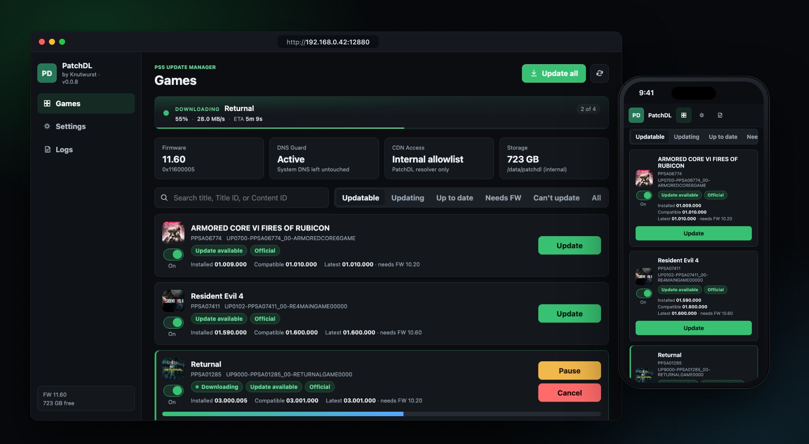
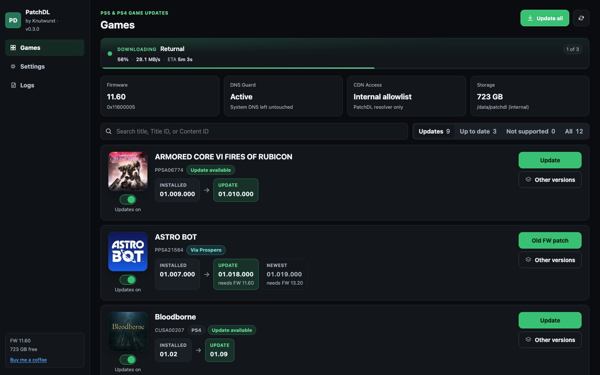
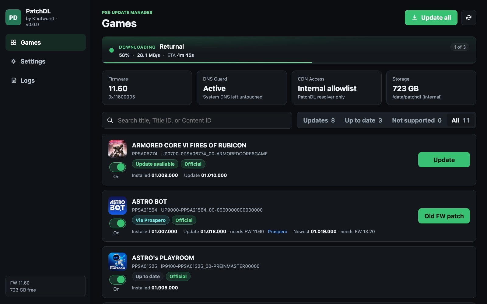
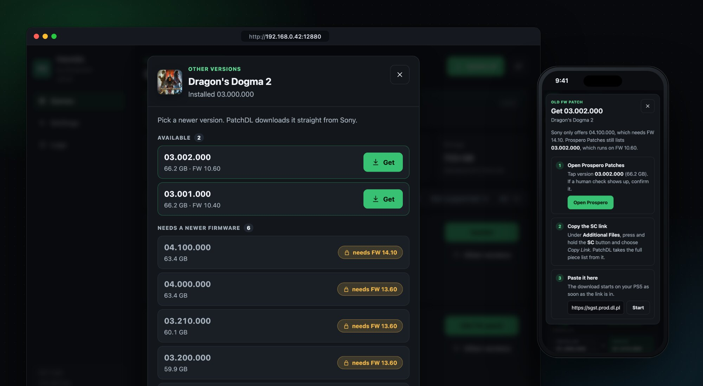
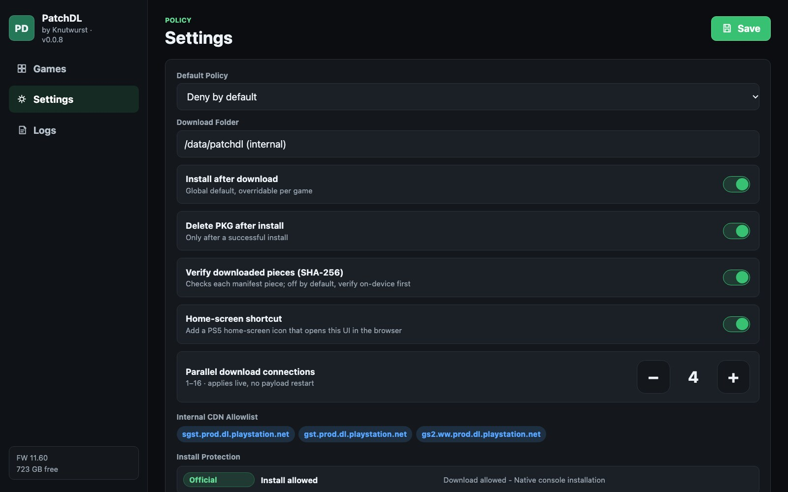
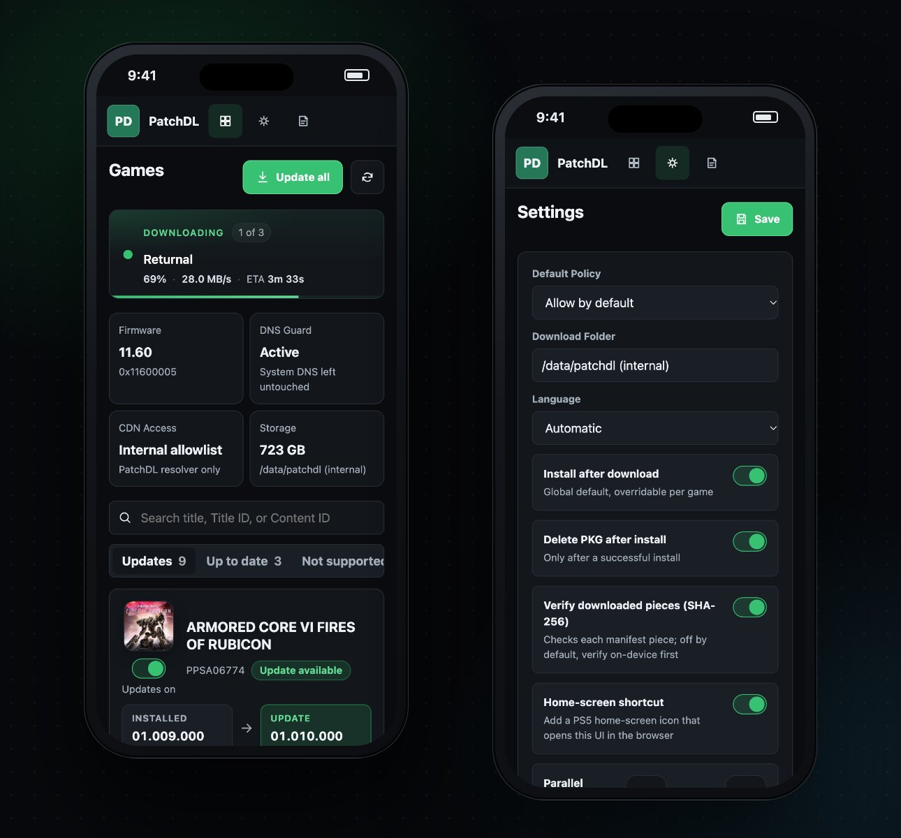

<h1 align="center">PatchDL — TESTONLY fork</h1>

<p align="center">
  <strong>Unofficial fork of <a href="https://github.com/knutwurst/ps5-patchdl">knutwurst/ps5-patchdl</a> with the firmware-compatibility filter removed.</strong>
</p>

<p align="center">
  
  
  
  
  
  
</p>

---

## ⚠️ What changed vs upstream

Four local changes — two server patches, one new server endpoint, and one
small Web UI addition. The install path, the download pool, the Prospero
integration and every other upstream behaviour are left untouched.

### 1. Firmware-compatibility filter removed

**`src/patchdl_verxml.c`** (around line 165):

```diff
-            if (pkg_sver <= fw_bin) {
+            if (1) { /* TESTONLY: accept any firmware for backport workflow */
```

The upstream build hides patches whose declared firmware requirement is above
the installed firmware (`required_fw > fw_bin`). This fork removes that filter
so every patch Sony returns in `version.xml` is treated as a `compatible`
candidate — regardless of the firmware it asks for.

### 2. Per-piece CDN URLs exposed in `/api/manifest/<tid>`

**`src/patchdl_websrv.c`** (`/api/manifest` handler):

```diff
-            jbuf_appendf(&j, "{\"o\":%lld,\"s\":%lld,\"h\":\"%s\"}",
-                         mf.pieces[i].offset, mf.pieces[i].size, mf.pieces[i].hash);
+            jbuf_appendf(&j, "{\"o\":%lld,\"s\":%lld,\"h\":\"%s\",\"u\":\"%s\"}",
+                         mf.pieces[i].offset, mf.pieces[i].size, mf.pieces[i].hash,
+                         mf.pieces[i].url ? mf.pieces[i].url : "");
```

Upstream `/api/manifest/<tid>` returns each piece's offset, size and SHA-256,
but not its CDN URL — those come from Sony's `_sc.pkg` manifest, which only
the console cert can fetch from `sgst.prod.dl.playstation.net`. This fork
adds `"u"` (the per-piece URL on `gst.prod.dl.playstation.net`, served over
plain HTTPS with no client cert) next to the hash so an external downloader
(FDM, aria2, curl) on the same LAN can pull the chunks directly, verify them
against `"h"` and reassemble the package byte-perfectly — useful when the
console's connection is slow or when the patch is tens of GB and you'd
rather use a desktop.

### 3. Single-piece fetch endpoint

**New** `GET /api/fetch_piece/<title_id>/<idx>`
(`src/patchdl_websrv.c`, next to the existing `/api/manifest/` handler):

```http
GET /api/fetch_piece/PPSA04029/25

{ "ok": true,
  "idx": 25,
  "size": 131334144,
  "got":  131334144,
  "sha_ok": true,
  "sha_got":  "731cc814…",
  "sha_want": "731cc814…",
  "path": "/data/patchdl/PPSA04029/pieces/piece_25.bin",
  "url":  "https://sgst.prod.dl.playstation.net/sgst/prod/.../_sc.pkg" }
```

Streams one piece from the title's manifest to
`/data/patchdl/<title_id>/pieces/piece_<idx>.bin`, SHA-256 verifies it
against the hash the manifest declares, and reports back. It stays out of
the main download pool, so it can be used while a normal download is paused
or finished — most useful to grab the single `sgst.*` piece (the signed
`_sc.pkg`, which needs the console's client cert) in isolation while the
large `gst.*` CDN chunks are pulled off-console.

### 4. "Pieces" modal in the Web UI

A new **Pieces** button appears on every title card, next to the existing
*Other versions* button. It opens a sheet with:

- One row per manifest piece: index, host (green **gst** / amber **sgst**),
  size, short SHA-256, source filename.
- Per-row `Copy URL` and `Fetch` (calls `/api/fetch_piece/…`, shows the
  SHA check result inline).
- A toolbar with three one-click actions:
  - **Export Metalink (CDN)** — downloads a Metalink v4 (`.metalink`)
    file listing only the public `gst.*` chunks with sizes, SHA-256s and
    URLs; drop it into aria2 (`aria2c -x16 -j25 --check-integrity=true -i`)
    or any Metalink-aware downloader on another machine.
  - **Copy all CDN URLs** — copies the plain `gst.*` URL list to the
    clipboard.
  - **Fetch _sc.pkg only** — finds the single `sgst.*` piece in the
    manifest and calls the fetch endpoint for it; the 131 MB sidecar is
    cached under `/data/patchdl/<tid>/pieces/`.

Nothing in this sheet changes install behaviour; it only surfaces data the
backend already fetches and adds a convenient way to pull one specific
piece without draining the whole pool.

### What this unlocks

- `latest_compatible` and `compatible_url` get populated for patches above
  your current firmware too, so the download/install endpoints
  (`/api/titles/<tid>/download`, `/api/titles/<tid>/install`) stop replying
  with `no_compatible_patch`.
- You get the real `_sc.pkg` manifest URL for a brand-new patch straight
  from Sony's own `sgst.prod.dl.playstation.net` (using the console's cert),
  without waiting for third-party scrapers like Prospero Patches to index it.
- `GET /api/manifest/<title_id>` now returns, for every chunk, the direct
  `gst.prod.dl.playstation.net` URL — enabling off-console assembly against
  Sony's own SHA-256 hashes.
- `GET /api/fetch_piece/<title_id>/<idx>` can grab a single piece on
  demand (so the mTLS-only `_sc.pkg` can be fetched without pulling the
  rest of the patch through the console's uplink).
- The new **Pieces** sheet in the Web UI exposes all of the above as
  one-click actions — including a Metalink export of the public CDN
  chunks, ready to feed to any desktop downloader.

### What this does **not** change

- Only games installed from disc or the PlayStation Store are still eligible
  (shadowmount / unknown / fake sources are rejected upstream).
- Install still needs the game to be present under the matching TitleID.
- The install itself is handed to the console's own installer, which may
  reject the package via its own checks.
- Nothing is modified in the game, Sony's keys or the system software.

### Why "TESTONLY"

**This fork is intended as a research / backport-workflow aid for packages
you legally own.** The upstream firmware filter exists for a good reason:
installing a patch that was built for a firmware you don't have usually
produces a game that doesn't launch, crashes, or (worst case) corrupts save
data in a way that even reinstalling the previous patch cannot recover.
You are expected to:

- Only use this on titles **you have purchased** on your account.
- Back up any save you care about before the first launch after a backport.
- Keep the original package handy so you can roll back if the patched game
  refuses to run.

Do not install updates that need a firmware newer than yours just because
you can; most of them won't work.

### Everything else is upstream

The firmware range (1.00–13.60), launch instructions, settings, i18n and
screenshots are **exactly those of the upstream project**. The only
additions in this fork are the two source-level patches, the extra
`/api/fetch_piece/<tid>/<idx>` endpoint and the "Pieces" sheet in the Web
UI described above — the download pool, installer, auto-update loop,
Prospero Patches integration and configuration format are untouched.
Everything else below this section is the upstream README, kept verbatim
so the setup steps still apply.

---

## Credit

All of PatchDL — the payload, the web UI, the Prospero Patches integration,
the parallel downloader, the installer glue, the ten-language i18n and the
documentation — is the work of **[knutwurst](https://github.com/knutwurst)**
([ps5-patchdl](https://github.com/knutwurst/ps5-patchdl)).

If you find this useful, please support the original author:

<p>
  <a href="https://paypal.me/oliverkoester"></a>
</p>

This fork adds four local changes on top of upstream — the firmware
filter, the `/api/manifest` response, the new `/api/fetch_piece` endpoint
and the Web UI "Pieces" sheet. Please file issues about PatchDL
functionality itself upstream; only report issues here if they are
specifically about one of those local changes.

---

<p align="center">
  — Upstream README follows below, unchanged —
</p>

---

<h1 align="center">PatchDL</h1>

<p align="center">
  
</p>

<p align="center">
  Downloads and installs official updates for PS5 and PS4 games, controlled from any browser.
</p>

<p align="center">
  
  
  
  
  
</p>

<p align="center">
  <a href="https://github.com/knutwurst/ps5-patchdl/releases/latest">
    
  </a>
</p>

<p align="center">
  If you like what I do, you can buy me a coffee*:
  <a href="https://paypal.me/oliverkoester"></a><br>
  <sub>*It doesn't have to be a generous donation. A few cents are enough to show me who is interested in further development. So the motivation stays and I just know that I am not programming for the bin ;)</sub>
</p>

---

## What it does

PatchDL runs as a payload on the PS5 and serves a small web page. Open that page on your phone, your laptop or in the console's browser and you get a list of your installed games with their version and the latest update Sony has for them. Click Update, and PatchDL downloads the patch from Sony's servers and hands it to the console's own installer.

A few things it does on top of that:

- Update all queues every game that has an update and works through them one by one.
- Downloads use several connections at once (4 by default, up to 16).
- If the newest patch needs a firmware you don't have, PatchDL looks for the latest one that still runs on your console. Under Other versions you can pick any version of a patch yourself.
- A download that gets interrupted continues where it stopped, also after a pause or a restart of PatchDL.
- After a successful install the package is deleted. You can switch that off.
- Optionally every piece is checked against Sony's checksums.
- There's a switch for a PatchDL tile on the home screen.
- The interface is available in ten languages.

PatchDL only updates games installed from disc or the PlayStation Store. It doesn't download games, and it doesn't touch system software.
## Screenshots

<table>
  <tr>
    <td align="center" width="50%"><br><sub>Games with updates</sub></td>
    <td align="center" width="50%"><br><sub>All installed games</sub></td>
  </tr>
  <tr>
    <td align="center" width="50%"><br><sub>Picking another version</sub></td>
    <td align="center" width="50%"><br><sub>Settings</sub></td>
  </tr>
  <tr>
    <td align="center" width="50%"><br><sub>On a phone</sub></td>
    <td align="center" width="50%"><br><sub>Home screen tile</sub></td>
  </tr>
</table>

## Installation

1. Download `patchdl_<version>.elf` from the [latest release](https://github.com/knutwurst/ps5-patchdl/releases/latest).
2. Send it to your PS5 with the ELF loader you already use.
3. The console shows a notification with the address, e.g. `http://192.168.0.42:12880/`. Open it in a browser on the same network.

You need a PS5 that can load ELF payloads. PatchDL should run on firmware 1.00 to 13.60; I've tested it on 11.60 and 13.60.

## FAQ

**Where do the updates come from?**
From Sony's update servers, the same files the console would download itself. Nothing gets modified. To find Sony's servers PatchDL uses public DNS (Cloudflare, Google, Quad9) and leaves the console's DNS settings alone, so if you block system updates through DNS, that block stays in place.

**How does it know about older patches?**
Sony only tells the console about the newest patch. The version history comes from [Prospero Patches](https://prosperopatches.com/) for PS5 games and [Orbis Patches](https://orbispatches.com/) for PS4 games. PatchDL sends them the game's title ID, nothing else.

**How do I get a specific version?**
Open Other versions on the game, pick a version and follow the steps. You copy one link from the patch site (on the PS5 you scan a QR code and do that part on your phone), paste it, and PatchDL downloads that version from Sony. Only versions newer than the installed one can be installed.

**When is the package deleted?**
Only after the console reports the new version and its installer has registered the package. Otherwise it stays. You can turn deleting off in Settings.

**Do disc games work?**
Yes. Keep the disc in the drive while the update installs.

**What if the power goes out during a download?**
Start PatchDL again and press Resume.

## Disclaimer

PatchDL is an independent project and not affiliated with or endorsed by Sony Interactive Entertainment. "PlayStation", "PS5" and "PS4" are trademarks of Sony Interactive Entertainment Inc.

PatchDL downloads official, unmodified updates for games that are already installed. It doesn't download games, doesn't contain Sony software, keys or game content, and doesn't install unsigned or modified packages. Use it with games you own. Issues about pirated content will be closed.

## Building

```sh
scripts/build_ps5.sh        # builds patchdl-ps5.elf
```

This needs the [ps5-payload-dev SDK](https://github.com/ps5-payload-dev/sdk) (0.44 or newer) with `libcurl` and `OpenSSL` from its [pacbrew-repo](https://github.com/ps5-payload-dev/pacbrew-repo). `libmicrohttpd` and SQLite are included in the repo. Every push is built by GitHub Actions, and tags become releases.

To try a build on your console:

```sh
PS5_HOST=<console-ip> scripts/deploy_ps5.sh
```

## Credits

Built on [libmicrohttpd](https://www.gnu.org/software/libmicrohttpd/), [libcurl](https://curl.se/), [OpenSSL](https://www.openssl.org/), [SQLite](https://sqlite.org/) and the [ps5-payload-dev SDK](https://github.com/ps5-payload-dev/sdk). The patch history comes from [Prospero Patches](https://prosperopatches.com/) and [Orbis Patches](https://orbispatches.com/). Thanks to everyone working on these.

## Support

If you like what I do, you can buy me a coffee*: [](https://paypal.me/oliverkoester)

<sub>*It doesn't have to be a generous donation. A few cents are enough to show me who is interested in further development. So the motivation stays and I just know that I am not programming for the bin ;)</sub>

## License

GNU General Public License v3.0 or later, see [LICENSE](LICENSE).

Copyright © 2026 Knutwurst.
